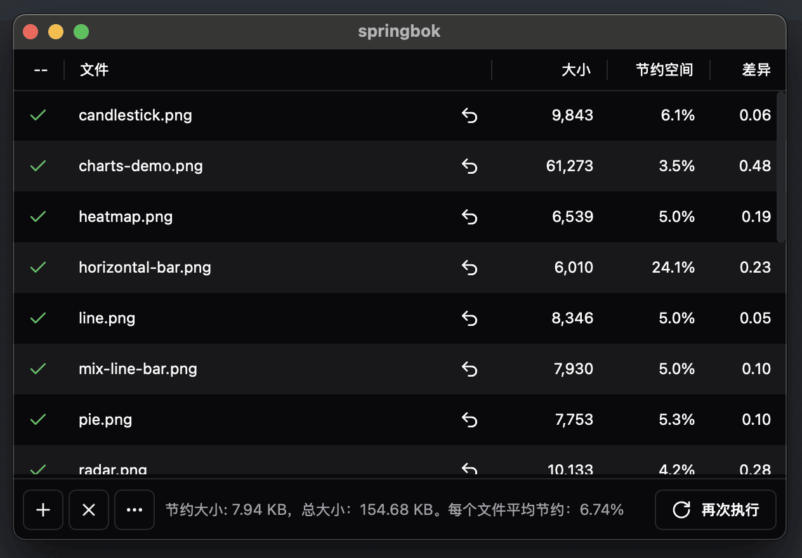

# springbok

`springbok` 是一款基于 Tauri 构建的桌面图片优化工具，支持图片压缩与格式转换。

## 功能特性

- **图片压缩**：支持 PNG、JPEG 压缩，可配置各格式压缩质量
- **格式转换**：可将图片转换为 WebP、AVIF、JXL 格式
- **输出目录**：可指定独立输出目录，保留原文件不被覆盖
- **EXIF 清除**：一键清除图片元数据（位置、设备信息等）
- **质量预设**：内置高/中/低三档质量预设，一键应用
- **并行处理**：支持 1~4 个并发任务，同一文件的不同转换格式保持串行
- **跳过已优化**：通过 blake3 哈希检测已优化文件，避免重复处理
- **延迟启动**：添加文件后不自动处理，点击开始按钮后才执行

## 使用说明

- 拖拽图片或文件夹到程序窗口，或点击左下角 `+` 按钮选择文件
- 配置输出目录（可选）：点击工具栏 `FolderDown` 按钮选择目录，不设置则原地覆盖
- 点击 `开始` 按钮执行压缩与转换
- `差异` 列基于人眼视觉（dssim）比对压缩前后图片，值大于 1 时图片质量可能较差，可点击恢复原图
- 点击 `Eraser` 按钮可单独清除所有文件的 EXIF 元数据

## 注意事项

- 差异值使用 dssim 算法比较压缩前后的人类视觉差异，一般小于 1 则无明显差别
- WebP、AVIF、JXL 均通过原图转换生成，指定输出目录时保存至该目录，否则保存在原图同级目录

# License

This project is Licensed under [Apache License, Version 2.0](./LICENSE).
